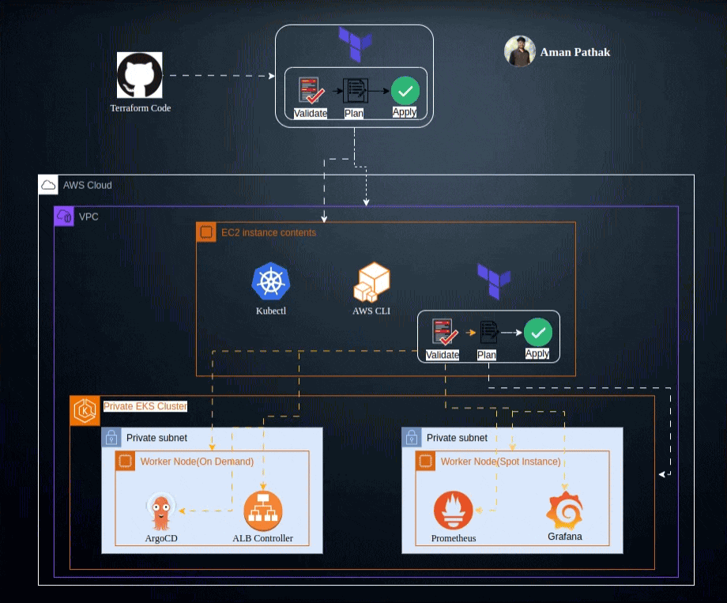

# EKS GitOps and observability

Portfolio lab maintained in [bckish/eks-gitops-observability](https://github.com/bckish/eks-gitops-observability). The implementation is derived from upstream work; this repository's documentation and validation changes do not imply an independently verified cloud deployment.

Terraform lab for an AWS VPC and deployment host, a private EKS cluster, Argo CD, Prometheus/Grafana and AWS Load Balancer Controller.



## Layout and local validation

The [vpc-ec2](vpc-ec2/) root prepares networking and the deployment host; the [eks](eks/) root configures the cluster and Helm releases. Both use [module](module/) and require Terraform 1.13.3 or later, below 2.0. Run `bash validate.sh` to initialize, validate and run a plan test with all providers explicitly mocked. These synthetic plan tests do not contact AWS or Kubernetes, load remote state or apply changes. The real EKS cluster is cloud infrastructure, not a local cluster.

```bash
git clone https://github.com/bckish/eks-gitops-observability.git
cd eks-gitops-observability
terraform -chdir=vpc-ec2 init -backend=false
terraform -chdir=vpc-ec2 validate
terraform -chdir=eks init -backend=false
terraform -chdir=eks validate
```

Provider downloads require internet access. Before planning, configure your own S3 state backend for each root, review [variables.tfvars](variables.tfvars), and use a suitable AWS identity and region. The private EKS endpoint needs a reachable deployment host. Plan the VPC/EC2 root first, then EKS; review both plans before any apply. Avoid automatic approval. EKS, NAT gateways, EC2 and load balancers can incur ongoing charges. No cluster availability or monitoring results are claimed here.

## Attribution and license

Original implementation by Aman Pathak. See [UPSTREAM.md](UPSTREAM.md) for the source repository and [LICENSE](LICENSE) (MIT). The upstream license and copyright notices are unchanged.
